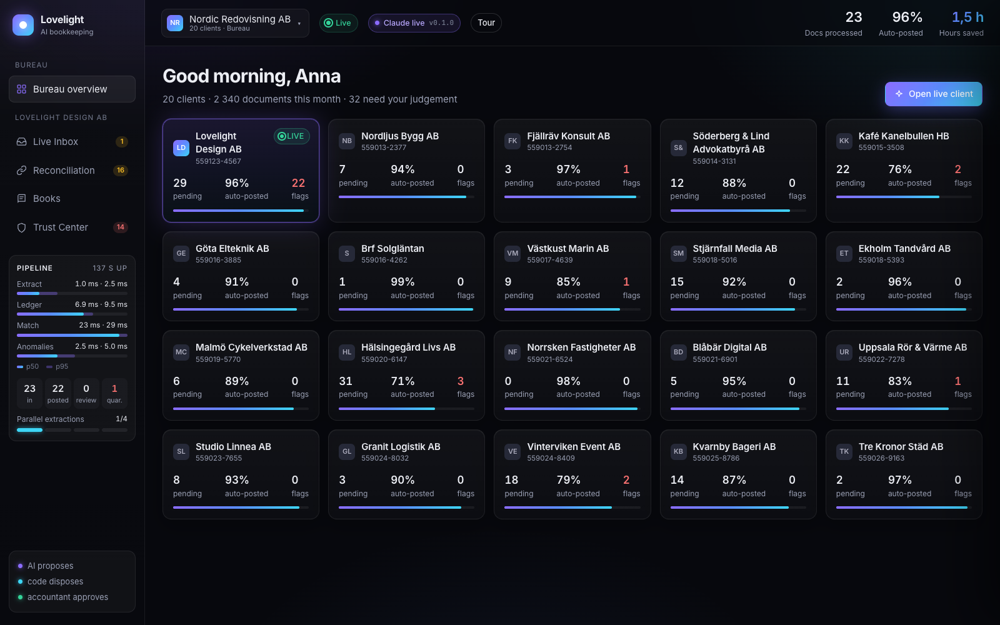
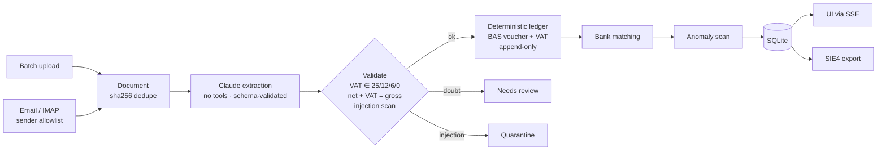

# Lovelight

**A shoebox of receipts goes in. Balanced, bank-reconciled Swedish books come out, ready for Fortnox or Visma.**


> **AI proposes, code disposes, accountant approves.** Claude reads documents. Deterministic code does every krona of
> money math. A human signs off on anything the system is not sure about.

## The problem

Accounting bureaus spend most of their month on low-judgement work:

- **One document at a time.** Every receipt, invoice and phone photo gets keyed in by hand.
- **Manual bank matching.** Bank lines get ticked off against documents one by one, including a single payment that
  covers several invoices.
- **No trust in AI black boxes.** An LLM that "does the bookkeeping" can't be audited, can miscount VAT, and can be
  steered by a malicious invoice.

## What it does

| | |
| --- | --- |
| **Batch intake.** Drag in 1 or 1000 files, or forward them by email. Claude extracts each field with a confidence score. Code builds a balanced BAS voucher and shows a full audit trail (sha256, model, prompt version). |  |
| **Explainable bank matching.** Scoring uses vendor, amount, date and OCR reference, including 1 payment → 3 invoices. You can approve every match at ≥ 95% confidence with one click. |  |
| **Books, in Swedish GAAP.** Resultaträkning, balansräkning, the Skatteverket VAT boxes and the voucher list. One-click SIE4 (PC8) export that Fortnox and Visma import natively. |  |
| **Trust Center.** Prompt injections are quarantined, never executed. Deterministic rules catch duplicates, IBAN changes, VAT mismatches, missing receipts and fat-finger amounts. |  |
| **Bureau overview.** One screen shows all clients: what is pending, the auto-post rate and open flags. |  |

## Architecture



Extraction runs concurrently (`LOVELIGHT_MAX_CONCURRENCY`, default 4) and ledger writes are serialized under a lock.
Each stage is timed and reported at `/api/metrics` (p50/p95/max). Design rationale is in [DECISIONS.md](DECISIONS.md).

## Trust model: AI proposes, code disposes, accountant approves

| Layer | Who | Guarantee |
| --- | --- | --- |
| Propose | Claude | Returns fields only. No tools, so it cannot pay, post or send. Output is parsed into a strict pydantic schema or rejected. |
| Dispose | Code | Builds the voucher from BAS rules, which keeps it balanced by construction (debit = credit, re-checked before write). The VAT rate is restricted to legal Swedish rates and the arithmetic is re-verified. |
| Guard | Code | Rule-based anomaly scan where every flag names the rule that fired. Injected or unknown-sender email is quarantined and never auto-posted. |
| Approve | Accountant | Uncertain matches and flagged documents wait for a human. The ledger is append-only: corrections are reversal vouchers. |

Secrets live only in `.env` (git-ignored, documented in [.env.example](.env.example)). A repo-quality test scans every
publishable file for keys, app passwords, private keys and local paths.

## Verified results

These results come from the deterministic demo replay (23 inbox documents + 153 Light sandbox AR invoices, with
gold-cache extraction and no network). The anomaly, injection, Light-hold and balance invariants are asserted in
[tests/test_acceptance.py](tests/test_acceptance.py); the exact counts and totals are from a replay run.

| Check | Result |
| --- | --- |
| Planted inbox anomalies caught (injection, IBAN change, duplicate, VAT mismatch, missing receipt) | **5 / 5, 0 false positives** |
| Prompt-injection document | Quarantined, **0 kr posted** |
| Planted errors in the Light AR export flagged *and* held from posting | **10 / 10** |
| Every voucher balanced (debit = credit) | **166 / 166** |
| Balance sheet balances (assets = equity + liabilities) | **10 831 091,47 kr = 10 831 091,47 kr** |
| Inbox documents auto-posted | **22 / 23 (96%)** |
| Payment matched to 3 supplier invoices via OCR references | **97% confidence** |
| Replay is idempotent (same bytes are booked once) | ✓ |
| Test suite (`uv run pytest tests/`) | **55 passed** |

## Quickstart

You need [uv](https://docs.astral.sh/uv/) and Python 3.12. No API key is required: without one, extraction falls back
to a cached gold set, so the demo runs offline and deterministically.

```bash
uv sync
cp .env.example .env                       # optional: add ANTHROPIC_API_KEY for live Claude extraction
uv run python scripts/generate_data.py     # synthetic inbox, bank.csv, gold extractions -> data/generated/
uv run uvicorn lovelight.server:app --port 8000
```

Open <http://localhost:8000/?tour=1> for a guided ~75 s walkthrough (space pauses, ← → step through, esc exits),
or open <http://localhost:8000> and press **Replay demo batch**. `?mock=1` runs the UI with no backend.

```bash
uv sync --group dev
uv run pytest tests/                       # unit, acceptance and repo-quality gates; live-API tests skip without a key
uv run ruff check src tests scripts
```

## Project layout

```
src/lovelight/
  models.py      shared pydantic contract
  extract.py     Claude extraction → strict schema; gold-cache fallback
  ledger.py      vouchers, VAT, P&L, balance sheet, VAT return (pure)
  matching.py    bank ↔ document scoring with reasons (pure)
  anomalies.py   deterministic fraud / data-quality rules (pure)
  sie.py         SIE4 writer (PC8)
  pipeline.py    concurrent ingest, ledger lock, SSE event bus
  metrics.py     per-stage latency + counts
  server.py      FastAPI routes + static UI
  intake.py      IMAP poller + upload intake
  static/        single-page UI, guided tour, mock backend
scripts/         synthetic data generator, demo email sender
tests/           unit, acceptance, live-API (opt-in), repo-quality gate
docs/            screenshots, original hackathon brief
```

<details>
<summary>HTTP API and configuration</summary>

| Method | Path | Purpose |
| --- | --- | --- |
| GET | `/api/state` | Full snapshot: documents, bank, matches, vouchers, anomalies, reports, stats |
| GET | `/api/events` | Server-sent events (`doc.received`, `voucher.posted`, `match.found`, `anomaly.found`, ...) |
| GET | `/api/health` | Status, version, counts, `extraction_mode` (`live` / `gold-cache`) |
| GET | `/api/metrics` | Per-stage latency (p50/p95/max), counts, concurrency, uptime |
| POST | `/api/upload` | Multipart `files`, extracted concurrently |
| POST | `/api/demo/replay` | Replay the synthetic inbox (`?live=1` uses real Claude calls) |
| POST | `/api/demo/reset` | Clear state and metrics |
| POST | `/api/matches/{id}/approve` | Approve one bank match |
| POST | `/api/matches/approve-all` | Approve all matches with confidence ≥ 0.95 |
| GET | `/api/export/sie4` | Download the books as SIE4 |
| GET | `/api/documents/{id}/file` | Original source document |

| Variable | Effect |
| --- | --- |
| `ANTHROPIC_API_KEY` | Live Claude extraction. Unset: gold-cache mode |
| `GMAIL_USER`, `GMAIL_APP_PASSWORD` | Enable the IMAP inbox poller |
| `SENDER_ALLOWLIST` | Comma-separated senders allowed to auto-post |
| `LOVELIGHT_DB` | SQLite path (default `data/lovelight.db`) |
| `LOVELIGHT_MAX_CONCURRENCY` | Parallel extractions per batch (default 4) |

</details>

## Roadmap

- Open-banking feed (Tink) instead of bank CSV
- Direct Fortnox/Visma API push alongside SIE4
- Period close: accruals, FX revaluation, VAT return filing
- Multi-tenant bureau workspace on EU-hosted Postgres
- Accountant corrections become per-client few-shot examples

## Credits

Built at the **Light x Lovable x Grant Thornton** finance hackathon in Stockholm (October 2026), then hardened into this
repo. The original brief and prompts are in [docs/hackathon/](docs/hackathon/). Licensed under [MIT](LICENSE).
